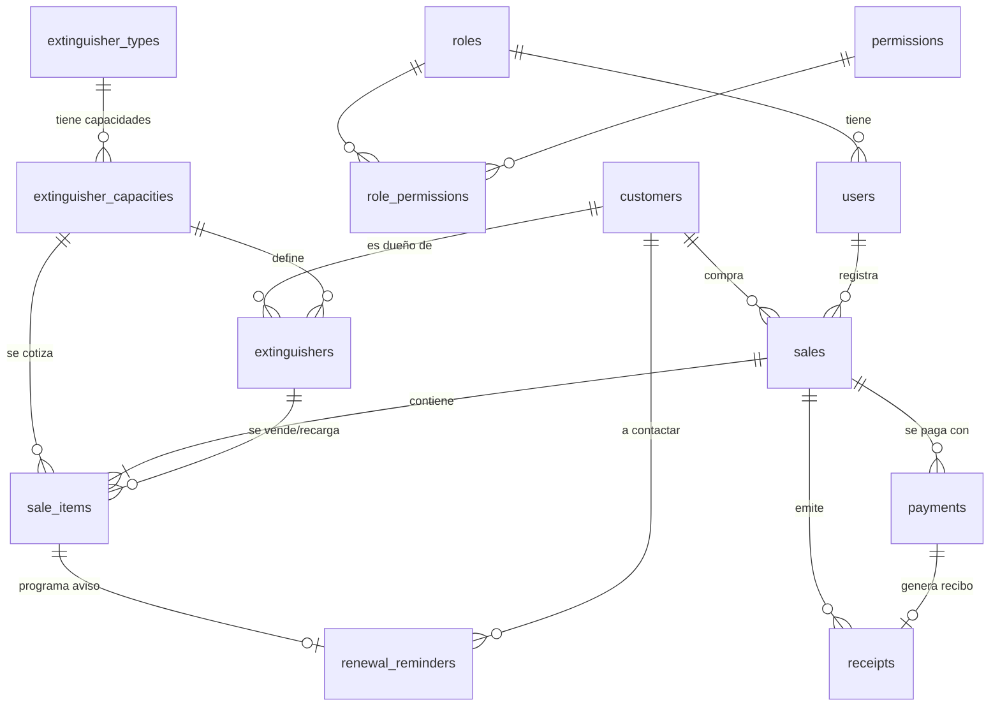

# FireExtracking API – Diseño de tablas (borrador v2)

Stack: NestJS + Prisma + PostgreSQL (misma base de convenciones que `maintain-api`, con BD nueva propia).

## 1. Convenciones (heredadas de maintain-api)

- Tablas en `snake_case` plural (`@@map`), modelos Prisma en `PascalCase` singular.
- PK `id` UUID (`@default(uuid())`).
- **Auditoría en todas las tablas**: `created_by`, `updated_by`, `deleted_by` (UUID de `users`), `is_deleted` (soft delete), `deleted_at`, `created_at`, `updated_at` (`Timestamptz`).
- Auth: login con `user_name` + `password` (argon2), JWT + refresh token (hash), roles y permisos por módulo.
- Dinero: `Decimal(12,2)`. Fechas de calendario (carga/vencimiento): `Date`; momentos: `Timestamptz`.
- Variables de entorno de la BD nueva: `DATABASE_URL` (conexión directa; las aporta el usuario; no se reutiliza nada de maintain-api).

> Abajo, "auditoría" = los 7 campos anteriores. Se omiten en cada tabla para no repetir.

## 2. Diagrama de relaciones

## 3. Seguridad

### `roles`
| Campo | Tipo | Notas |
|---|---|---|
| name | varchar(80) unique | Por ahora 2: **Administrador** (configura todo) y **Vendedor** (registra ventas) |
| description | varchar(255) null | |

### `permissions`
| Campo | Tipo | Notas |
|---|---|---|
| name | varchar(80) unique | Ej: `customers.read`, `sales.create`, `settings.update` |
| description | varchar(255) null | |
| order | int null | |

### `role_permissions`
`role_id`, `permission_id` · unique(role_id, permission_id)

### `users`
| Campo | Tipo | Notas |
|---|---|---|
| user_name | varchar(80) unique | Login |
| password | varchar(255) | hash argon2 |
| refresh_token | varchar(255) null | hash |
| first_name | varchar(120) | |
| last_name | varchar(120) | |
| url_photo | varchar(500) null | |
| role_id | uuid FK roles | |

Semilla inicial: roles Administrador y Vendedor, permisos por módulo y un usuario administrador.

## 4. Catálogo de matafuegos y precios

La unidad de medida **depende del tipo** (kg o litros), por eso va en el tipo y las capacidades son un catálogo por tipo. Cada capacidad es además la lista de precios.

### `extinguisher_types` (tipos)
| Campo | Tipo | Notas |
|---|---|---|
| code | varchar(20) unique | `K`, `ABC`, `BC`, `BC_CO2`, `HCFC`, `A`, `AFFF` |
| name | varchar(120) | "ABC polvo", "BC polvo", "BC anhídrido carbónico (CO2)", "HCFC", "Clase K", "Clase A", "AFFF" |
| unit | enum | `KG` o `LT` |
| order | int null | |
| is_active | bool default true | |

### `extinguisher_capacities` (capacidades + precios)
| Campo | Tipo | Notas |
|---|---|---|
| type_id | uuid FK extinguisher_types | |
| capacity | decimal(6,2) | 1, 2.5, 5, 10… (la unidad la da el tipo) |
| sale_price | decimal(12,2) null | Precio de **venta** del matafuego (con carga) |
| recharge_price | decimal(12,2) null | Precio de **recarga** |
| order | int null | |
| is_active | bool default true | |

unique(type_id, capacity). Etiqueta calculada para la ficha y pantallas: `ABC x 5 kg`, `K x 6 lts`.

**Semilla inicial con lo informado:**

| Tipo | Unidad | Capacidades |
|---|---|---|
| ABC polvo | kg | 1, 2.5, 5, 10, 25, 50, 100 |
| BC polvo | kg | 1, 2.5, 5, 10, 25, 50, 100 *(confirmado: iguales a ABC)* |
| BC anhídrido carbónico | kg | 2, 3, 3.5, 5, 7, 10, 20, 45 |
| HCFC | kg | 2.5, 5, 10 |
| K | lts | 6 |
| Clase A | lts | 10, 25, 50, 100 |
| AFFF | lts | 10, 25, 50, 100 |

Los precios se cargan después desde el front (el Administrador). El precio del ítem en la venta se copia como valor editable, así cambios futuros de lista no alteran ventas pasadas.

## 5. Tablas del negocio

### `customers` (clientes)
| Campo | Tipo | Notas |
|---|---|---|
| customer_type | enum `PERSON`\|`COMPANY` | Default `PERSON` (persona humana / persona jurídica) |
| first_name | varchar(120) null | **Obligatorio si PERSON**; en COMPANY siempre null |
| last_name | varchar(120) null | **Obligatorio si PERSON**; en COMPANY siempre null |
| business_name | varchar(200) null | **Razón social. Obligatoria si COMPANY** |
| cuit | varchar(11) null | Solo dígitos, con dígito verificador válido. **Obligatorio si COMPANY**, opcional en PERSON. Sin unique en BD (por el borrado lógico); la API rechaza duplicados activos (409) |
| phone | varchar(30) | **Obligatorio** (para contactar renovaciones) |
| address | varchar(255) null | Opcional (*Domicilio* de la ficha) |
| email | varchar(255) null | Opcional (el front enviará los PDF) |
| notes | varchar(500) null | |

Índices: `phone`, `(last_name, first_name)`, `business_name`, `cuit`.
Check en BD `customers_type_required_fields_chk`: PERSON exige nombre y apellido; COMPANY exige razón social y CUIT y no tiene nombre ni apellido.
La API devuelve además `displayName` (calculado, no se guarda): razón social para COMPANY, "Nombre Apellido" para PERSON.

### `extinguishers` (envases)
Envase físico. Se crea en el momento de la venta/recarga si hace falta.

| Campo | Tipo | Notas |
|---|---|---|
| customer_id | uuid FK customers null | Dueño actual |
| capacity_id | uuid FK extinguisher_capacities | Define tipo + capacidad ("Tipo y Capacidad" de la ficha) |
| serial_number | varchar(60) null | *Extintor N°* |
| manufacture_date | date null | *Fecha Fabric.* |
| hydraulic_test_due_date | date null | *Vto. Prueba Hidra.* |
| brand_id | uuid FK brands null | Marca |
| license_plate | varchar(10) null | Última patente informada (matafuegos de 1 kg). Se usa para precargar en las recargas |
| status | enum | `IN_STOCK`, `SOLD`, `CUSTOMER_OWNED`, `OUT_OF_SERVICE` |
| notes | varchar(500) null | |

Índices: `serial_number`, `customer_id`, `brand_id`.
El N° de serie es opcional en la tabla pero la API lo exige al vender o recargar un matafuego.

### `brands` (marcas)
| Campo | Tipo | Notas |
|---|---|---|
| name | varchar(80) | Único entre las marcas activas (lo valida la API, sin distinguir mayúsculas) |

Solo `name` más los campos de auditoría y borrado lógico comunes. Índice: `name`.

> Recargas: hoy el cliente deja su envase y se lleva otro. Se registra como ítem `RECHARGE` sobre el envase del cliente; el manejo del "canje" queda para una etapa posterior.

### `sales` (ventas)
| Campo | Tipo | Notas |
|---|---|---|
| sale_number | int unique (secuencial) | Nº interno |
| customer_id | uuid FK customers | |
| seller_id | uuid FK users | |
| sale_date | timestamptz | |
| total_amount | decimal(12,2) | Suma de ítems |
| paid_amount | decimal(12,2) default 0 | Suma de pagos |
| balance_amount | decimal(12,2) | `total - paid` |
| payment_status | enum | `PENDING`, `PARTIAL`, `PAID` |
| status | enum | `ACTIVE`, `CANCELLED` |
| notes | varchar(500) null | |

### `products` (productos y kits)
Los matafuegos **no** están acá: son tipo + capacidad (`extinguisher_capacities`).

| Campo | Tipo | Notas |
|---|---|---|
| kind | enum | `PRODUCT` o `KIT` |
| name | varchar(120) | **Obligatorio**, único entre los activos (lo valida la API) |
| price | decimal(12,2) | **Obligatorio**. En un `KIT` es el precio fijo del kit |
| stock | int null | **Obligatorio en `PRODUCT`** (>= 0). En `KIT` es null: se calcula con sus componentes |
| brand_id | uuid FK brands null | Opcional |
| is_active | boolean default true | |

Checks en BD: precio >= 0; `PRODUCT` exige stock >= 0; `KIT` no tiene stock. Índices: `name`, `brand_id`.

### `product_kit_items` (componentes de un kit)
| Campo | Tipo | Notas |
|---|---|---|
| kit_id | uuid FK products | El kit |
| product_id | uuid FK products null | Componente producto (no puede ser otro kit) |
| capacity_id | uuid FK extinguisher_capacities null | Componente matafuego (tipo + capacidad) |
| quantity | int >= 1 | |

Check: exactamente uno de `product_id` / `capacity_id`.

### `stock_movements` (historial de stock, inmutable)
| Campo | Tipo | Notas |
|---|---|---|
| product_id | uuid FK products | |
| delta | int | Positivo suma, negativo resta |
| stock_after | int | Stock resultante |
| reason | enum | `INITIAL`, `ADJUSTMENT`, `SALE`, `SALE_CANCELLED` |
| sale_item_id | uuid FK sale_items null | Línea de venta que lo originó |
| notes | varchar(255) null | |

### `sale_items` (detalle; una ficha por ítem con envase)
| Campo | Tipo | Notas |
|---|---|---|
| sale_id | uuid FK sales | |
| extinguisher_id | uuid FK extinguishers null | Null si no es matafuego |
| capacity_id | uuid FK extinguisher_capacities null | Origen del precio sugerido |
| product_id | uuid FK products null | Producto o kit vendido |
| parent_item_id | uuid FK sale_items null | Si es componente de un kit, apunta a la línea `KIT` que lo contiene |
| item_type | enum | `NEW_SALE`, `RECHARGE`, `PRODUCT`, `KIT`, `OTHER` |
| description | varchar(255) | Renglón del comprobante ("Matafuego ABC x 5 kg") |
| quantity | int default 1 | |
| unit_price | decimal(12,2) | Editable |
| subtotal | decimal(12,2) | |
| charge_date | date null | **Fecha Carga** = fecha de la venta |
| expiration_date | date null | **Vencimiento Cargas** = `charge_date + 1 año` |
| tag_owner_name | varchar(240) null | *Propietario* impreso (snapshot) |
| tag_address | varchar(255) null | *Domicilio* impreso (snapshot) |
| tag_license_plate | varchar(10) null | *Patente* impresa (snapshot). La API la exige en matafuegos de 1 kg |
| tag_printed_at | timestamptz null | |
| tag_print_count | int default 0 | |

> La **ficha** se genera en PDF desde `sale_items` + `extinguishers` + `customers` + datos del negocio (encabezado: nombre, teléfono, domicilio). No tiene tabla propia.

### `payments` (pagos, incluye parciales)
| Campo | Tipo | Notas |
|---|---|---|
| sale_id | uuid FK sales | |
| amount | decimal(12,2) | |
| method | enum | `CASH`, `TRANSFER`, `DEBIT_CARD`, `CREDIT_CARD`, `OTHER` |
| paid_at | timestamptz | |
| reference | varchar(120) null | |
| notes | varchar(255) null | |

Al registrar/anular un pago se recalculan `paid_amount`, `balance_amount` y `payment_status`.

### `receipts` (comprobantes internos)
| Campo | Tipo | Notas |
|---|---|---|
| type | enum | `FACTURA_X` (por el **total** de la venta) · `RECIBO_PAGO_X` (**recibo de pago**: uno por cada pago, parcial o total) |
| point_of_sale | varchar(4) | Tomado de la configuración (por defecto `0001`) |
| number | varchar(8) | Correlativo por tipo; unique(type, point_of_sale, number). Se muestra `0001-00000001` |
| sale_id | uuid FK sales | |
| payment_id | uuid FK payments null | Solo en recibos de pago |
| customer_id | uuid FK customers | |
| issued_at | timestamptz | |
| total_amount | decimal(12,2) | Factura: total de la venta · Recibo: monto del pago |
| paid_to_date | decimal(12,2) null | Acumulado pagado a esa fecha (recibos) |
| balance_after | decimal(12,2) null | Saldo que queda (recibos) |
| pdf_url | varchar(500) null | PDF guardado; el envío por email lo hace el front |
| status | enum | `ISSUED`, `VOID` |

> Nombre sugerido para el comprobante parcial: **"Recibo de pago"** (también sirve para el último pago que cancela el saldo, donde indicaría saldo $0).

### `renewal_reminders` (avisos de vencimiento)
| Campo | Tipo | Notas |
|---|---|---|
| sale_item_id | uuid FK sale_items unique | |
| extinguisher_id | uuid FK extinguishers | |
| customer_id | uuid FK customers | A quién contactar |
| due_date | date | Vencimiento de la carga |
| notify_from | date | `due_date - renewal_notice_days` |
| status | enum | `PENDING` → `NOTIFIED` → `CONTACTED` → `RENEWED` / `DISMISSED` |
| notified_at | timestamptz null | |
| contacted_at | timestamptz null | |
| contacted_by | uuid FK users null | |
| renewed_sale_item_id | uuid null | Recarga que lo cerró |
| notes | varchar(500) null | |

El panel "A contactar" (cliente y teléfono) **no depende de un job**: muestra los avisos abiertos (`PENDING` o `NOTIFIED`) con `notify_from <= hoy`, y la API devuelve ese estado calculado. El job diario (`@nestjs/schedule`) solo deja constancia pasando esos avisos a `NOTIFIED` con `notified_at`. Solo notificación **dentro del sistema** por ahora. Como los días de anticipación son configurables, al guardar `renewal_notice_days` se recalcula `notify_from` de los avisos abiertos (`PENDING` y `NOTIFIED`): los que todavía no llegaron a su nueva fecha vuelven a `PENDING` (con `notified_at` en null) y `CONTACTED`, `RENEWED` y `DISMISSED` no se modifican.

### `business_settings` (datos del negocio y configuración – una sola fila)
| Campo | Tipo | Notas |
|---|---|---|
| business_name | varchar(160) | Ej. "Matafuegos B.N." |
| address | varchar(255) null | |
| phone | varchar(40) null | |
| email | varchar(255) null | |
| logo_url | varchar(500) null | |
| point_of_sale | varchar(4) default `'0001'` | |
| factura_x_next_number | int default 1 | Próximo Nº de Factura X; ajustable desde el front |
| recibo_pago_x_next_number | int default 1 | Próximo Nº de Recibo de pago; ajustable |
| renewal_notice_days | int default 3 | Días de anticipación del aviso (configurable; se usarán 2 o 3) |
| tag_validity_months | int default 12 | Vigencia de la carga (vencimiento = carga + 12 meses) |

El número se toma e incrementa dentro de una transacción para no repetir. Reemplaza a la tabla `receipt_counters` del v1.

## 6. Flujo de una venta (mostrador)

1. Buscar/crear **cliente** (nombre, apellido, teléfono).
2. Elegir tipo y capacidad (precio sugerido de la lista, editable); N° de extintor si lo tiene. Si el envase no existe se crea.
3. Fecha de carga = hoy; vencimiento = +12 meses.
4. Se guarda venta + ítems y se crea el aviso de renovación de cada ítem.
5. Se emite **Factura X** (total) y, si hay pago, el **Recibo de pago**.
6. Se generan en PDF la **ficha** y los comprobantes (el front los envía por email).
7. Pagos posteriores → nuevo `payment` + `RECIBO_PAGO_X` con saldo restante.

## 7. Módulos NestJS previstos

`auth`, `users`, `roles`, `permissions`, `role-permissions`, `customers`, `extinguisher-types`, `extinguisher-capacities`, `extinguishers`, `sales` (con ítems), `payments`, `receipts` (PDF), `renewal-reminders` (+ cron), `tags` (PDF de ficha), `business-settings`, `common`, `prisma`.

## 8. Decisiones confirmadas

- Capacidades de BC polvo = las de ABC polvo (confirmado por el negocio).
- Aviso de renovación: 2 o 3 **días** antes (default 3, configurable).
- Precio de venta y de recarga separados; los carga el Administrador.
- Comprobante parcial = "Recibo de pago". Formato `0001-00000001`.
- `DATABASE_URL` (única variable de BD, conexión directa) la coloca el usuario luego en el `.env`.
